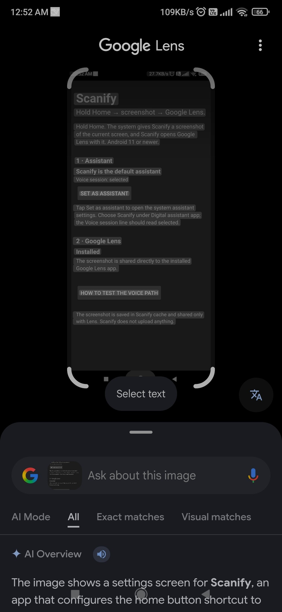

# Scanify

Hold Home → the system gives Scanify the current screen → Google Lens.



Android 11+ · no accessibility service · no MediaProjection · no accessibility permission.

## Background

Google Assistant's screen search was replaced by Gemini, and Gemini does not hand the current screen to Google Lens. On MIUI the **Assist and voice input** settings still expose **Use text from screen** and **Use screenshot**, but the screenshot side is part of the platform assistant API: a `VoiceInteractionService` session receives it through `onHandleScreenshot(Bitmap)` when shown with `SHOW_WITH_SCREENSHOT`. An `ACTION_ASSIST` activity only receives the assist text/structure, not pixels.

Scanify implements that voice-session path. The app is the selected digital assistant; a Home press starts the session, the platform supplies a full-screen bitmap, and Scanify opens Lens with it.

## Verified

On MIUI / Android 11 with no accessibility service enabled:

```text
I Scanify : voice session shown, flags=7
I Scanify : onHandleScreenshot: 1080x2340
```

`flags=7` is `SHOW_WITH_ASSIST | SHOW_WITH_SCREENSHOT | SHOW_SOURCE_ASSIST_GESTURE`. `1080x2340` is the full display.

The screenshot above shows the result: the current Scanify screen opened inside Google Lens, with **Select text** available.

## Install

1. Download `Scanify-release.apk` from [Releases](https://github.com/AM-RTS/Scanify/releases/latest).
2. Install it on the phone. Android 11 or newer.
3. Open **Scanify**.
4. Tap **Set as assistant**; the button opens the system assistant settings (falling back to Default apps).
5. Choose **Scanify** under **Digital assistant app**.
6. Return to Scanify and confirm **Voice session: selected**.
7. Hold Home.

No accessibility service needs to be enabled.

## Boot, MIUI and force-stop behavior

- Android binds the selected `VoiceInteractionService` itself; the app does not need to auto-open.
- Scanify includes a `BOOT_COMPLETED` receiver. If the voice session is no longer selected after a reboot, it posts a notification that opens Scanify so you can reselect it.
- The receiver **cannot restore the assistant setting automatically**. Writing `Settings.Secure` requires privileged access.
- MIUI is aggressive about killing background apps. Enable **Autostart** for Scanify, set battery saver to **No restrictions**, and lock it in recents.
- An explicit **force stop** puts Scanify in the stopped state; its services cannot run and MIUI falls back to Google. No unprivileged app can prevent that. Reselect after the next launch or restore automatically with root/privileged access.

## Permissions and privacy

The app requests only:

- `RECEIVE_BOOT_COMPLETED` — to post the reselect reminder after boot.
- `POST_NOTIFICATIONS` — to show that reminder on Android 13+.

No dangerous permissions, no internet permission, no accessibility service. The screenshot is saved as `screen.png` in the app cache (overwritten on each capture) and shared only with Lens. Scanify does not upload anything.

## If Home does not open Lens

Check the selected service:

```text
adb shell settings get secure voice_interaction_service
adb shell settings get secure assistant
```

Point them at Scanify if needed:

```text
adb shell settings put secure voice_interaction_service com.scanify.assist/com.scanify.assist.ScanifyVoiceInteractionService
adb shell settings put secure assistant com.scanify.assist/com.scanify.assist.AssistActivity
```

Logs:

```text
adb logcat -s Scanify
```

A working run shows `voice session shown, flags=…` and `onHandleScreenshot: WIDTHxHEIGHT`. If MIUI starts the activity path instead, the app shows a toast saying so and exits. If no screenshot arrives, it shows the “no system screenshot” toast.

## Responsiveness

- The assistant session window is transparent; Scanify does not draw a full-screen UI.
- The PNG encode and cache write run on a background thread (`scanify-save`), not the main thread.
- `adb logcat -s Scanify` reports the timing: `onHandleScreenshot: 1080x2340 (+Xms)` and `screenshot saved in Yms`.
- A brief black frame can still come from Lens's own cold start. That part is outside Scanify.

## Build

```text
./gradlew assembleRelease
```

AGP 8.13.1, Gradle 8.14.3, compileSdk 35, minSdk 30, targetSdk 34, Java 17. No third-party dependencies.

The release build intentionally uses `signingConfigs.debug` for personal sideloading. **No signing keys are included in this repository.** The official APK in Releases is signed with the maintainer's local debug key; a fresh build on another machine will have a different signature and cannot update over it without uninstalling first.

## Implementation

- `ScanifyVoiceInteractionService` — selected assistant service.
- `ScanifySessionService` / `ScanifySession` — receives the platform screenshot, saves it off the main thread, and opens Lens.
- `ScanifyRecognitionService` — required no-op recognition stub; no microphone use.
- `ScreenshotProvider` — read-only content provider for the PNG; Lens gets a URI read grant.
- `AssistActivity` — kept as the `ACTION_ASSIST` entry point; it only shows a toast if a ROM uses the activity path.
- `BootReceiver` — posts a reselect reminder if the voice session is not selected at boot.

## Limitations

- MIUI can reset the assistant selection or prevent third-party assistants from autostarting. This cannot be fixed from an unprivileged app.
- `FLAG_SECURE` screens may produce a black screenshot or no screenshot.
- The voice session path requires the platform to deliver `SHOW_WITH_SCREENSHOT`; if the device uses the activity path, there is no capture.
- Personal debug-key signature; not intended for Google Play.

## Lens handoff

`GoogleLens.apk` was decompiled for reference: `com.google.ar.lens/com.google.vr.apps.ornament.app.lens.LensLauncherActivity` is exported and accepts `ACTION_SEND` with `image/jpeg` and `image/png`, reading `Intent.EXTRA_STREAM` as a `Uri`. Scanify supplies that URI through its read-only provider with `FLAG_GRANT_READ_URI_PERMISSION`, so Lens reads the PNG directly and no copy is left in the gallery.
